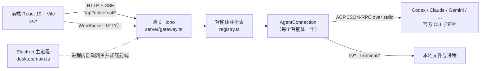

# ACP Studio

> **English summary** — ACP Studio is a desktop (Electron) and web workbench for any coding agent that speaks the
> [Agent Client Protocol (ACP)](https://agentclientprotocol.com) over stdio. It ships presets for Codex, Claude Code,
> Gemini CLI, Cursor CLI, GitHub Copilot CLI, OpenCode, DeepSeek Harness and Google Antigravity, reuses each CLI's own
> local login (no API keys stored), and gives you sessions & history, a permission-approval flow, tool-call/plan
> visualisation, an integrated PTY terminal, @-file mentions and git diff review/undo for each agent turn.
> Stack: React 19 + Vite + Tailwind v4 front end, Hono gateway (Bun or Node), Electron shell.

ACP Studio 是一个**通用 ACP 编码智能体工作台**：把任何支持 ACP（Agent Client Protocol）的命令行编码智能体接进同一个图形界面，
在桌面端（Electron）或浏览器里和它们对话、审批它们的操作、查看它们改了哪些文件。

<!-- 截图：仓库里目前没有界面截图。建议补一张主界面截图放到 docs/images/ 再在这里引用。 -->

---

## 功能

以下功能都已在代码中实现（括号内为主要实现位置）：

**多智能体接入**
- 内置 8 个预设，统一走各家官方 CLI，复用其本地登录态，Studio 不保存任何密钥（`server/universal/presets.ts`）
- 自定义智能体：界面里添加，或用 `ACP_AGENTS_JSON` 环境变量 / `~/.acp-studio/agents.json` 配置 `{id, command, args, env}`（`server/universal/registry.ts`、`src/components/universal/CustomAgentModal.tsx`）
- 连接时做 `initialize` 能力协商，按智能体实际能力开关界面功能（fork、providers、附加目录、图片输入等）

**会话**
- 新建 / 加载（历史回放）/ 恢复 / 列表 / 关闭 / 删除 / fork 会话；可设置 cwd、附加目录、MCP servers（`src/hooks/useSessionLifecycle.ts`、`src/components/universal/SessionSettingsModal.tsx`）
- 本地会话记录（按智能体隔离，存浏览器 localStorage，`src/lib/threads.ts`）
- 模式切换、模型 / 思考等级等配置项、Providers 面板（`ModelBrowserModal.tsx`、`ProvidersModal.tsx`）

**对话与可视化**
- 流式渲染正文、思考过程（可折叠）、工具调用状态、计划（plan）、slash 命令联想、token 用量与费用（`src/lib/universal-api.ts`、`src/components/assistant/`）
- Markdown + 代码高亮（Shiki）+ Mermaid 图（按需加载）
- 附件：文本、图片、文件拖拽 / 粘贴
- `@` 引用工作区文件（只读搜索，限定在 cwd 内，`/api/universal/workspace/files`）
- 生成中继续发送会进入队列；支持“插队”；传输类错误自动重试（默认 2 次）（`src/hooks/useChatSend.ts`）

**审批与表单**
- 智能体请求权限（`session/request_permission`）时弹出审批卡片（`PermissionDialog.tsx`）
- 智能体请求结构化输入（`elicitation/create`）时按 JSON Schema 渲染表单（`ElicitationCard.tsx`）

**代码相关**
- 代替智能体读写文件（ACP `fs/read_text_file`、`fs/write_text_file`）、托管其终端命令（ACP `terminal/*`）（`server/universal/AgentConnection.ts`）
- 集成终端：Node 网关下为真 PTY（`node-pty` + WebSocket，可跑 vim / ssh），Bun 网关下回落为单次命令执行；浮动面板、搜索、导出日志（`server/universal/pty.ts`、`TerminalDrawer.tsx`）
- Git 改动查看：工作区状态、逐文件 diff（左右对照 / 统一 diff）、暂存、还原（`GitChangesModal.tsx`、`/api/universal/git/*`）
- 本轮改动撤销：每条回复下方显示“改动 N”，可逐个文件查看 diff 或 `git restore` 还原（`src/components/assistant/TurnChanges.tsx`）

**外观**
- 4 套主题：dark / oled / dim / light，终端配色跟随主题（`src/stores/useThemeStore.ts`）

## 支持的智能体

| 预设 ID | 名称 | 启动命令 | 登录方式 |
| --- | --- | --- | --- |
| `codex` | Codex | `bunx @agentclientprotocol/codex-acp@latest`（无 bun 时 `npx -y`） | 复用 `~/.codex/auth.json`，或 `OPENAI_API_KEY` / `CODEX_API_KEY` |
| `claude` | Claude Code | `bunx @agentclientprotocol/claude-agent-acp@latest` | 复用 Claude Code 本地登录 |
| `gemini` | Gemini CLI | `gemini --acp` | 复用 Gemini CLI 登录 |
| `cursor-cli` | Cursor CLI | `agent acp` | 复用 Cursor CLI 登录 |
| `copilot` | Copilot CLI | `copilot --acp --stdio` | 复用 Copilot CLI 登录 |
| `opencode` | OpenCode | `opencode acp` | 复用 OpenCode 配置 |
| `deepseek` | DeepSeek Harness | `bunx @deepseek-ai/dsh@latest --profile acp` | 见 dsh 文档 |
| `antigravity-stdio` | Antigravity | `bunx @yitom/agy-acp-map@latest` | 需先安装并登录 Google Antigravity CLI（`agy`） |

需要先自行安装对应的官方 CLI 并完成登录；未安装时连接会直接报错并给出安装提示。

## 架构



- **前端**（`src/`）：React 19、assistant-ui、zustand（客户端状态）+ TanStack Query（服务端状态）、Tailwind CSS v4、xterm.js。
- **网关**（`server/`）：同一个 Hono 应用有两个入口——`server/index.ts`（Bun，开发默认）和 `server/node.ts`（Node，支持真 PTY）。只监听 `127.0.0.1:3004`。
- **ACP 客户端层**（`server/universal/AgentConnection.ts`）：基于 `@agentclientprotocol/sdk`，为每个智能体托管一个 stdio 子进程，并把权限请求、表单请求转给前端。
- **桌面端**（`desktop/`）：Electron 主进程内启动 Node 网关，同源加载打包好的前端。

## 快速开始

### 环境要求
- [Bun](https://bun.sh) 1.2+（构建、开发脚本都用 bun）
- 至少一个已安装并登录的 ACP 智能体 CLI（见上表）
- Linux 上首次安装需要 C/C++ 编译工具（`build-essential`），因为 `node-pty` 没有 Linux 预编译包

### 开发

```bash
git clone --recurse-submodules https://github.com/yitom486/acp-studio.git
cd acp-studio
bun install

bun run dev            # 网关 http://127.0.0.1:3004 + 前端 http://localhost:5188
bun run dev:desktop    # Electron 桌面开发模式（默认 Bun 网关，终端为单次执行）
ACP_GATEWAY=node bun run dev:desktop   # 改用 Node 网关，启用真 PTY 终端
```

网关启动时会在终端打印一条 `open the UI with: http://localhost:5188/?token=...` 链接，用它打开 → 选择智能体 → 连接 → 新建会话 → 发送。

网关的所有 `/api/universal/*` 接口（包括终端执行）都要求访问令牌：Electron 桌面版自动带上；浏览器模式第一次用上面的链接打开，前端会记住令牌并从地址栏抹掉，也可以在令牌页粘贴 `~/.acp-studio/.gateway-token` 的内容。

### 检查与构建

```bash
bunx tsc --noEmit               # 类型检查
bunx vitest run tests/universal # 单元/集成测试（CI 同款，离线，不调用任何真实模型）
bun run build                   # 前端构建到 dist/
bun run build:electron          # 打包 Electron 主进程到 electron-dist/
bun run package:win             # 或 package:mac / package:linux，产物在 release/
```

### 安装包

到 [Releases](https://github.com/yitom486/acp-studio/releases) 下载：Windows（NSIS `.exe`）、macOS（Apple Silicon `.dmg` / `.zip`）、Linux（`.AppImage` / `.deb`）。安装包目前未签名，Windows 可能出现 SmartScreen 提示，macOS 需要在“隐私与安全性”里允许打开。

## 配置

| 变量 / 文件 | 作用 | 默认值 |
| --- | --- | --- |
| `PORT` | 网关端口 | `3004` |
| `ACP_AGENTS_JSON` | 追加 / 覆盖智能体定义（JSON 数组） | 空 |
| `ACP_AGENTS_FILE` | 自定义智能体持久化文件 | `~/.acp-studio/agents.json` |
| `ACP_WORKSPACE_ROOTS` | 额外允许智能体写入的目录（`;` 或 `:` 分隔）；会话工作区本身始终允许 | 网关当前目录 |
| `ACP_GATEWAY_TOKEN` | 网关访问令牌 | 自动生成，存于 `~/.acp-studio/.gateway-token` |
| `ACP_PUBLIC_DIR` | 网关托管的前端目录 | `./dist` |
| `ACP_GATEWAY` | `dev:desktop` 使用的网关（`bun` / `node`） | `bun` |

## 在 Zed 等编辑器中使用 Antigravity

Antigravity 桥接（`@yitom/agy-acp-map`）本身就是标准 ACP stdio 服务，可以直接配置进 Zed：

```json
{
  "agent_servers": {
    "antigravity": { "command": "bunx", "args": ["@yitom/agy-acp-map@latest"] }
  }
}
```

没装 bun 时把 `command` 换成 `npx`，`args` 换成 `["-y", "@yitom/agy-acp-map@latest"]`。更多细节见 [`docs/02_zed_integration_guide.md`](./docs/02_zed_integration_guide.md)。

## 项目结构

```text
acp-studio/
├── server/
│   ├── index.ts / node.ts       # Bun / Node 网关入口
│   ├── gateway.ts               # Hono 应用：鉴权、/api/universal/*、静态文件
│   └── universal/
│       ├── routes.ts            # HTTP / SSE 接口（智能体、会话、聊天、工作区、git、终端）
│       ├── AgentConnection.ts   # 单个智能体的 ACP stdio 连接
│       ├── registry.ts          # 智能体定义与活动连接
│       ├── presets.ts           # 内置预设
│       ├── pty.ts               # node-pty + WebSocket 终端
│       └── security.ts          # 令牌、CORS、工作区白名单
├── src/
│   ├── App.tsx                  # 主界面
│   ├── hooks/                   # 会话生命周期、发送、配置、启动
│   ├── stores/                  # zustand 状态
│   ├── lib/universal-api.ts     # 前端 API 与 SSE 解析
│   └── components/              # 聊天、侧边栏、终端、git、审批等组件
├── desktop/                     # Electron 主进程、preload、构建脚本
├── tests/                       # Vitest 测试（含离线 mock ACP agent）
├── docs/                        # 协议、Zed 集成、认证等文档
└── scratch/repos/yitom486-agy-acp-map   # Antigravity 桥接库（git submodule，仅联调用）
```

## 路线图

- [ ] 网关令牌真正生效：前端和非浏览器调用都必须带令牌
- [ ] 工作区白名单默认拒绝（文件读写、终端、git 都受限）
- [ ] 会话历史持久化到本地数据库（目前只存 localStorage，且不保存工具调用）
- [ ] 文件树与代码查看 / 编辑器
- [ ] 基于检查点的撤销（不依赖 git）
- [ ] 提交、分支、PR 等 Git 操作
- [ ] 多个会话并行运行
- [ ] 跨会话的用量与费用统计

## 参与贡献

1. Fork 并新建分支
2. 提交前运行 `bunx tsc --noEmit` 和 `bunx vitest run tests/universal`
3. 在 `CHANGELOG.md` 的 `Unreleased` 小节添加条目
4. 提交 PR

项目约定见 `.agents/rules/`（错误处理、禁止静默降级、状态管理、UI 设计、版本管理）。

## 许可证

本项目基于 [MIT 许可证](LICENSE) 开源。
