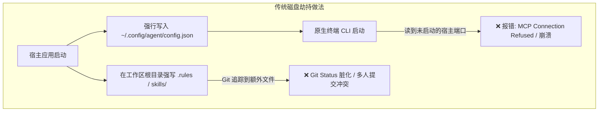
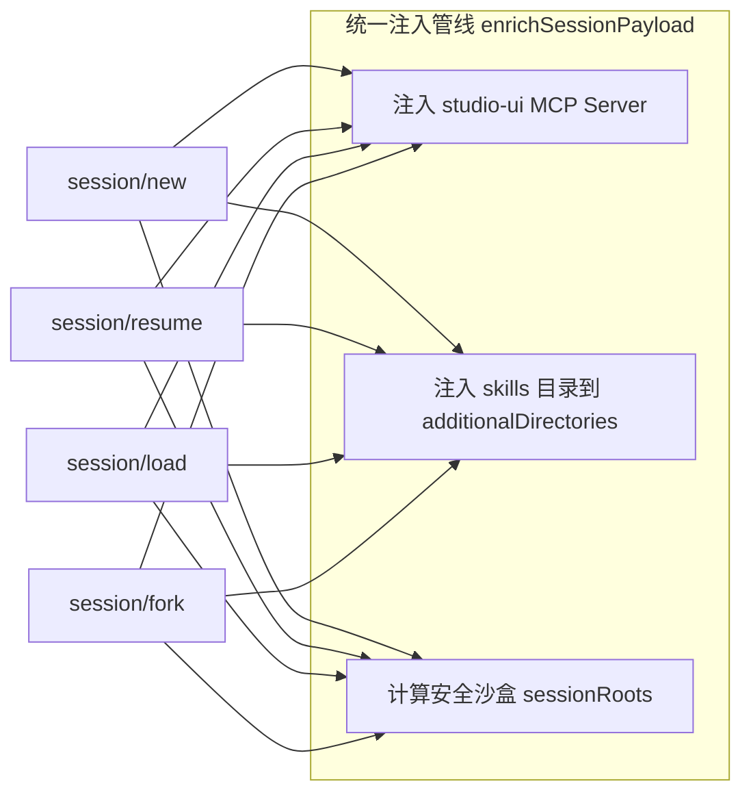

# ACP 架构下动态环境注入与零污染隔离设计范式
> **Whitepaper & Implementation Guide for ACP-Based AI Applications**  
> 从“提示词工程”走向“传输层环境编排”：在 Agent Client Protocol 中优雅实现专属工具、Skills 与系统提示的原生挂载。

---

## Executive Summary（执行摘要）

在构建基于大语言模型智能体（LLM Agents）的现代桌面客户端、IDE 插件或 Web Studio 时，开发者普遍面临一个核心诉求：  
**如何让宿主客户端专有的前端富交互组件（如交互式卡片、决策流、动态沙箱、出版级矢量流程图）和专业领域知识（Skills / System Prompts）被底层智能体原生识别并优先调用，同时绝对不破坏用户原本干净的开发环境？**

长期以来，业内充斥着两类**反模式（Anti-Patterns）**：
1. **磁盘强行侵入（Disk Mutation Anti-Pattern）**：直接向用户工作区注入 `.rules`、`.agents/skills` 或修改全局 `~/.codex/config.json`，导致 Git 仓库脏化、多人协同冲突与跨客户端死链报错；
2. **每轮强制提示词拼接（Every-Turn Prompt Stuffing Anti-Pattern）**：在用户发送的每个请求前硬塞大段规则文本，导致上下文 Token 严重浪费、注意力稀释（Attention Dilution）与“规则疲劳”导致的智能体失控。

本项目（Antigravity ACP Studio）在实践中沉淀出一套**基于 ACP（Agent Client Protocol）协议的“传输层动态环境编排与零污染隔离范式”**。本文详细拆解其底层原理、全对称生命周期模型以及在其他 AI 应用中的落地实现方案。

---

## 一、 为什么传统的“提示词提醒”与“磁盘侵入”走向破产？

### 1. 反模式 A：磁盘配置劫持与环境脏化



* **环境耦合与孤儿死链**：将宿主应用的 MCP 服务器（如 `http://localhost:13920/mcp`）强行写进用户全局配置。一旦宿主应用关闭，用户在终端启动原生 CLI 时，智能体会尝试连接死链，直接报错或卡死超时；
* **Git 仓库污染**：很多辅助工具会在项目目录下创建专属文件夹，不仅破坏版本控制的干净度，还常常因为文件权限问题导致代码审查（Code Review）失败。

### 2. 反模式 B：每轮提示词拼接（Every-Turn Prompt Stuffing）

许多前端实现为了“提醒”智能体，采用在每次调用 `prompt` 时无脑追加前缀：
```typescript
// ❌ 传统低效做法：每轮硬编码长文本
const badPrompt = `【系统提醒】：请务必记住你运行在 XXX 客户端！你有卡片 A、卡片 B 工具，请尽可能多用流程图！\n\n` + userMessage;
```
* **Token 成本与延迟爆炸**：如果会话有 30 轮，相同的提示词被重复下发 30 次，产生数万无效 Token 开销，并大幅拉长首字响应时间（TTFT）；
* **注意力失焦（Loss of Focus）**：根据大模型长上下文注意力衰减规律，重复下发相同规则会稀释模型对核心业务 Prompt 的关注度，反而导致工具调用准确率断崖式下跌；
* **假能力的幻觉风险**：在提示词中告诉模型“你可以使用卡片”，但底层 JSON-RPC 协议并没有给模型注册真正的 Tool Schema，导致模型生搬硬造伪 JSON 字符串，前端无法解析。

---

## 二、 核心原理：ACP 传输层动态环境编排

ACP（Agent Client Protocol）的底层是一套双向 JSON-RPC 2.0 通道。它不仅传输消息，更提供了**将环境挂载作为协议一等公民（First-Class Citizens）**的能力。

```mermaid
sequenceDiagram
    autonumber
    actor User as 用户
    participant Studio as ACP Studio (Host App)
    participant McpServer as Studio-UI MCP (HTTP Streamable)
    participant Agent as Agent Subprocess (e.g. Codex / Agy)
    participant LLM as LLM Engine

    Note over Studio,McpServer: 1. 宿主启动独立 5 位数端口 MCP 服务 (Streamable HTTP)
    Studio->>McpServer: 启动并注册专属工具 (show_interactive_card, render_diagram, etc.)
    
    Note over Studio,Agent: 2. 内存级协议握手，不触碰任何磁盘配置文件
    Studio->>Agent: ACP session/new (传递内存 args: mcpServers, additionalDirectories)
    Agent->>McpServer: 原生 MCP 初始化握手，拉取真实 Tool JSON-Schema
    McpServer--Agent: 返回工具定义与元数据
    
    Note over User,Studio: 3. 用户发起对话
    User->>Studio: 提问: "请帮我设计微服务架构决策"
    Studio->>Studio: 检查会话轮次 (Turn Count === 0)
    Studio->>Agent: session/prompt (首轮拼接轻量体验建议 Block)
    Agent->>LLM: 携带完整的原生工具 Schema + 首轮偏好
    LLM--Agent: 输出 tool_call: "show_interactive_card" (decision)
    Agent-->>Studio: session/update (tool_call 事件流)
    Studio->>User: 前端实时挂载交互式 Decision 卡片 (带推荐高亮与回调按钮)

    Note over User,Studio: 4. 用户第二轮对话
    User->>Studio: 点击 "确认方案 A"
    Studio->>Agent: session/prompt (Turn 1+: 100% 原始输入，零规则追加)
    Agent->>LLM: 干净上下文流转
```

### 1. 专属工具注入：动态 MCP 服务器传递
ACP 的 `session/new` 与 `session/resume` 原生支持 `mcpServers` 参数：
```json
{
  "cwd": "/workspace",
  "mcpServers": [
    {
      "type": "http",
      "name": "studio-ui",
      "url": "http://127.0.0.1:13920/mcp",
      "headers": []
    }
  ]
}
```
* **纯内存生命周期**：Agent 子进程在接到该 RPC 后，直接在内存中建立针对该 URL 的 MCP 客户端连接；
* **真工具定义**：模型得到的不仅是文本说明，而是具备严格类型约束的 JSON-Schema（如 `EditorialDiagramProps`、`InteractiveCardProps`）。

### 2. 专属知识注入：`additionalDirectories` 挂载
在 ACP 规范中，客户端可以向智能体宣告除工作区 `cwd` 之外的附加合法读取根：
```json
{
  "additionalDirectories": [
    "D:/project/app/server/universal/skills"
  ]
}
```
* 智能体可以将宿主应用安装目录下的内置 Skills 视为合法的扩展技能库；
* 智能体读取技能（`SKILL.md`）遵循标准只读授权，不会污染用户工作区。

### 3. 系统提示与偏好注入：Turn 0 软性引导（Soft Onboarding）
为了鼓励模型使用富组件，而不是强制或每轮说教，系统在 `AgentConnection.ts` 的 `prompt()` 方法中执行 Turn-0 引导：
* **首轮介入**：检测到 `turnCount === 0` 时，动态注入轻量的引导提示块（Client Generative UI Hint）；
* **后续免打扰**：从 `turnCount >= 1` 开始，永久恢复为 100% 原始用户输入，保证后续轮次的绝对纯净。

---

## 三、 会话全生命周期对称注入模型（Lifecycle Symmetry）

许多实现常犯的错误是**“只顾生，不顾活”**——只在 `newSession` 中注入了环境，导致用户只要一刷新、一重连或从侧边栏历史加载，专属能力便瞬间瓦解。

为此，应用必须抽象出统一的增强管线 `enrichSessionPayload`，并在所有生命周期切入点保持对称：



### 核心代码实现模式（以 TypeScript 为例）

```typescript
export class UniversalAgentConnection {
  private sessionTurnCounts = new Map<string, number>();

  /**
   * 统一参数增强器：保证所有生命周期切入点具备完全相同的环境能力
   */
  private enrichSessionPayload<T extends { cwd?: unknown; mcpServers?: unknown; additionalDirectories?: unknown }>(args: T) {
    const cwd = typeof args.cwd === "string" && args.cwd ? args.cwd : (this.profile.defaultCwd || process.cwd());
    
    // 1. 幂等合并 Skills 附加目录
    const additionalDirectories: string[] = Array.isArray(args.additionalDirectories)
      ? [...(args.additionalDirectories as string[])]
      : [];
    const skillsDir = getStudioSkillsDir();
    if (fs.existsSync(skillsDir) && !additionalDirectories.includes(skillsDir)) {
      additionalDirectories.push(skillsDir);
    }

    // 2. 幂等合并专属 MCP 服务
    const mcpServers = Array.isArray(args.mcpServers) ? [...(args.mcpServers as unknown[])] : [];
    const mcpInfo = getMcpUiServerInfo();
    if (mcpInfo) {
      const alreadyHas = mcpServers.some((s: any) => s && (s.name === mcpInfo.name || s.url === mcpInfo.url));
      if (!alreadyHas) {
        mcpServers.push({
          type: "http",
          name: mcpInfo.name,
          url: mcpInfo.url,
          headers: [],
        });
      }
    }

    // 3. 授权沙盒根路径更新
    const roots = this.fsGuard.sessionRootsFor(cwd, additionalDirectories);
    return { cwd, mcpServers, additionalDirectories, roots };
  }

  // 1. 新建会话
  async newSession(args: any) {
    const { cwd, mcpServers, additionalDirectories, roots } = this.enrichSessionPayload(args);
    const result = await this.conn.agent.request("session/new", { cwd, mcpServers, additionalDirectories });
    if (result?.sessionId) this.sessionTurnCounts.set(result.sessionId, 0);
    this.fsGuard.rememberSessionRoots(result?.sessionId, roots);
    return result;
  }

  // 2. 断点恢复会话
  async resumeSession(args: any) {
    const { cwd, mcpServers, additionalDirectories, roots } = this.enrichSessionPayload(args);
    const result = await this.conn.agent.request("session/resume", { ...args, cwd, mcpServers, additionalDirectories });
    const sid = args.sessionId || result?.sessionId;
    if (sid) this.sessionTurnCounts.set(sid, 0); // 重置引导计数器，进入 Studio 即激活
    this.fsGuard.rememberSessionRoots(sid, roots);
    return result;
  }

  // 3. 历史会话加载
  async loadSession(args: any) {
    const { cwd, mcpServers, additionalDirectories, roots } = this.enrichSessionPayload(args);
    const result = await this.conn.agent.request("session/load", { ...args, cwd, mcpServers, additionalDirectories });
    if (args.sessionId) this.sessionTurnCounts.set(args.sessionId, 0);
    this.fsGuard.rememberSessionRoots(args.sessionId, roots);
    return result;
  }
}
```

---

## 四、 多端共存与跨客户端互操作的“无缝退化”机制

在现代多 Agent 软件生态中，用户可能在多种客户端之间交替使用同一个项目或同一份会话历史（如官方 Codex CLI、OpenCode、Zed、Antigravity Studio）：

```
                  ┌──────────────────────────────────────────────┐
                  │          用户的本地持久化会话记录             │
                  │   ~/.codex/sessions/<session-id>.json        │
                  └──────┬────────────────────────────────┬──────┘
                         │                                │
          ┌──────────────┴──────────────┐  ┌──────────────┴──────────────┐
          │  场景 A: 原生终端 CLI 打开   │  │   场景 B: ACP Studio 打开    │
          │  (codex resume <session-id>)│  │ (Studio 恢复/加载该历史会话)│
          ├─────────────────────────────┤  ├─────────────────────────────┤
          │ • 无 studio-ui 注入         │  │ • 动态挂载 studio-ui MCP    │
          │ • 读纯文本历史 / 原生工具   │  │ • 重新挂载 Studio Skills     │
          │ • 100% 零死链、零报错       │  │ • 激活富组件、实时交互渲染  │
          └─────────────────────────────┘  └─────────────────────────────┘
```

### 1. 为什么原生终端 CLI 不会崩溃？
1. **只读本地配置**：原生客户端只读取 `~/.codex/config.json`，没有记录 Studio 的动态 HTTP 端口；
2. **Schema 容错**：会话历史中的 `tool_call`（例如 `show_interactive_card`）在原生终端只作为已完成的历史上下文，原生客户端不会试图调用一个未注册的工具；
3. **能力对齐**：原生终端继续使用它的标准能力（`bash`、`edit` 等），不会由于缺少 UI 组件而中断工作流。

### 2. 为什么回到 Studio 时能立刻唤醒？
当用户在 Studio 中重新 `loadSession` 或 `resumeSession` 时，由于全生命周期对称注入机制，Studio 的活跃端口与技能被重新带回，模型在下一轮生成中便能继续生成富组件。

---

## 五、 给其他 AI 应用开发者的实施清单（Implementation Checklist）

如果您正在开发自己的 AI IDE、智能体客户端或工作流工具，推荐按以下五步改造现有的提示词系统：

| 步骤 | 改造动作 | 预期收益 |
| :--- | :--- | :--- |
| **Step 1** | **停止修改用户本地配置文件**，将 MCP 服务从静态配置转为应用启动时按需监听的内存服务（推荐使用 HTTP Streamable 协议）。 | 根除孤儿端口死链，保证卸载/退出零垃圾残留。 |
| **Step 2** | **将纯文本 Rules 封装为标准 Skills**（带 YAML Frontmatter 的 `SKILL.md`），并通过 `additionalDirectories` 或 MCP `get_skill` 按需提供。 | 避免每次把海量规则全部打进 Prompt，实现模型按需检索（On-Demand Indexing）。 |
| **Step 3** | **实现 `enrichSessionPayload` 统一入口**，确保 `new`、`resume`、`load`、`fork` 拥有 100% 相同的基础设施环境。 | 会话重连、刷新、分支派生均具备一致的行为表现。 |
| **Step 4** | **采用 Turn-0 软性引导策略**，仅在会话第一轮追加客户端偏好建议，第二轮及以后恢复绝对纯净的用户输入。 | 上下文 Token 节省 90% 以上，显著提升模型的长程注意力。 |
| **Step 5** | **编写离线黑盒测试**，通过 Mock Agent 校验参数注入是否穿透到底层 RPC，形成不可退化的持续集成（CI）门禁。 | 确保协议升级或重构时不发生静默失效。 |

---

## 六、 总结与展望

从传统的“强灌提示词”与“暴力改配置”，演进到**“ACP 协议层动态编排与零污染隔离”**，标志着 AI 桌面应用从简陋的包装层（Wrapper）走向工业级成熟客户端架构。  
这种设计不仅最大程度释放了现代大模型的工具调用潜力，也体现了专业工程软件对用户系统环境与开源协作规范的敬畏。
